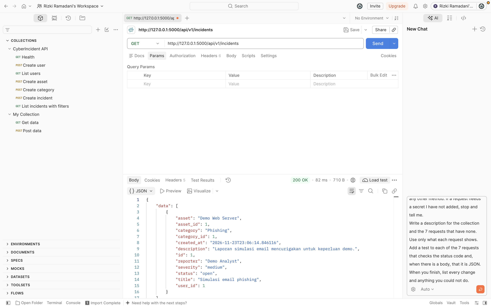
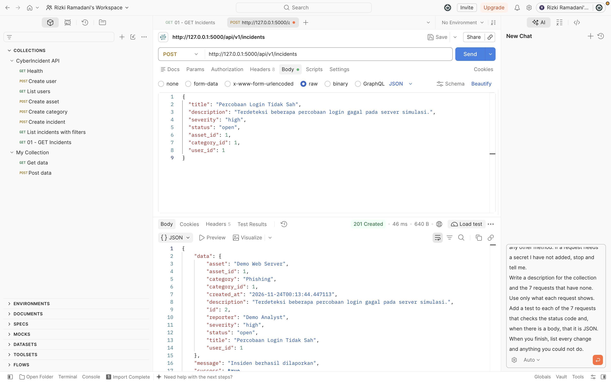
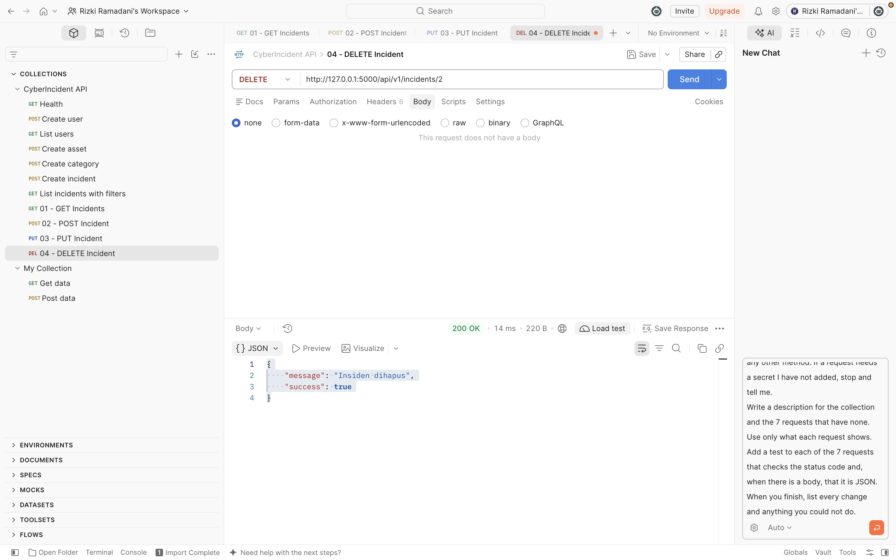

# CyberIncident API

CyberIncident API adalah REST API sederhana untuk mencatat dan mengelola laporan insiden keamanan siber. Proyek ini dibuat sebagai tugas Ujian Tengah Semester (UTS) mata kuliah Pemrograman Web Lanjut menggunakan Python Flask dan database SQLite.

## Identitas Mahasiswa

- **Nama:** Rizki Ramadani
- **NIM:** 23.83.1015
- **Program Studi:** S1 Teknik Komputer
- **Universitas:** Universitas Amikom Yogyakarta
- **Mata Kuliah:** Pemrograman Web Lanjut
- **Kode Mata Kuliah:** TK070

## 1. Tujuan Proyek

Proyek ini bertujuan mempermudah pencatatan laporan insiden keamanan siber, termasuk informasi pelapor, aset yang terdampak, kategori insiden, dan perkembangan penanganannya. Sistem menggunakan data simulasi untuk pembelajaran dan pengujian, bukan untuk menangani insiden sungguhan.

## 2. Teknologi yang Digunakan

- **Python dan Flask:** membangun REST API.
- **SQLite:** menyimpan data dalam database relasional.
- **Flask-SQLAlchemy:** mengelola database menggunakan ORM.
- **Flask-Migrate:** mendukung pengelolaan perubahan struktur database.
- **Gunicorn:** menjalankan aplikasi pada lingkungan server yang mendukungnya.
- **Postman:** menguji request dan response API.
- **pytest:** menjalankan pengujian otomatis.

## 3. Fitur Utama

- Menyimpan data pengguna, aset, dan kategori insiden.
- Menambah, melihat, mengubah, dan menghapus laporan insiden (CRUD).
- Mencatat perkembangan penanganan insiden.
- Menampilkan laporan menggunakan filter dan pagination.
- Mengembalikan kode HTTP dan pesan kesalahan saat data tidak valid atau tidak ditemukan.

## 4. Struktur Database dan ERD

Database menggunakan lima tabel yang saling berhubungan:

| Tabel | Fungsi |
|---|---|
| `users` | Menyimpan informasi pengguna atau pelapor. |
| `assets` | Menyimpan informasi aset yang terkait dengan insiden. |
| `incident_categories` | Menyimpan kategori atau jenis insiden. |
| `incidents` | Menyimpan laporan insiden keamanan siber. |
| `incident_updates` | Menyimpan riwayat perkembangan penanganan insiden. |

Diagram relasi dan atribut tabel tersedia di **[ERD CyberIncident API](docs/ERD.md)**.

## 5. Instalasi dan Menjalankan Proyek

Jalankan perintah berikut melalui terminal di folder proyek.

**1. Buat dan aktifkan virtual environment:**

```bash
python3 -m venv .venv
source .venv/bin/activate
```

**2. Instal dependency:**

```bash
pip install -r requirements.txt
```

**3. Siapkan konfigurasi dan data simulasi:**

```bash
python seed.py
```

Perintah `seed.py` membuat tabel database yang belum tersedia dan menambahkan data simulasi untuk pengujian.

**4. Jalankan aplikasi:**

```bash
python run.py
```

Alamat API lokal: `http://127.0.0.1:5000`

## 6. Demo API Online

CyberIncident API telah dijalankan melalui PythonAnywhere untuk keperluan demonstrasi UTS.

- **Health Check:** https://rizkirmadani.pythonanywhere.com/api/v1/health
- **Daftar Insiden:** https://rizkirmadani.pythonanywhere.com/api/v1/incidents

Demo menggunakan data simulasi. Ketersediaan layanan mengikuti ketentuan akun hosting yang digunakan.

## 7. Daftar Endpoint API

| Method | Endpoint | Kegunaan |
|---|---|---|
| `GET` | `/api/v1/health` | Memeriksa status API. |
| `GET` | `/api/v1/users` | Melihat daftar pengguna. |
| `GET` | `/api/v1/assets` | Melihat daftar aset. |
| `GET` | `/api/v1/incidents` | Melihat daftar laporan insiden. |
| `POST` | `/api/v1/incidents` | Menambahkan laporan insiden. |
| `GET` | `/api/v1/incidents/{id}` | Melihat detail laporan berdasarkan ID. |
| `PUT` | `/api/v1/incidents/{id}` | Memperbarui laporan insiden. |
| `DELETE` | `/api/v1/incidents/{id}` | Menghapus laporan insiden. |
| `GET` | `/api/v1/incidents/{id}/updates` | Melihat riwayat perkembangan insiden. |
| `POST` | `/api/v1/incidents/{id}/updates` | Menambahkan perkembangan penanganan. |

Dokumentasi endpoint lainnya tersedia di file [`openapi.yaml`](openapi.yaml). Koleksi pengujian manual tersedia di [`CyberIncident.postman_collection.json`](CyberIncident.postman_collection.json).

### Contoh Request dan Response

**Contoh request — Health Check**

```http
GET /api/v1/health
```

**Contoh response — HTTP 200 OK**

```json
{
  "message": "CyberIncident API is running",
  "success": true,
  "version": "1.0"
}
```

**Contoh request — Menambahkan insiden**

```http
POST /api/v1/incidents
Content-Type: application/json
```

```json
{
  "title": "Percobaan phishing",
  "description": "Ditemukan email mencurigakan yang meminta data akun.",
  "severity": "medium",
  "user_id": 1,
  "asset_id": 1,
  "category_id": 1
}
```

Jika request valid dan data referensi tersedia, API membuat laporan baru dengan status **201 Created**. Contoh response hasil POST yang sebenarnya dapat dilihat pada screenshot pengujian Postman di bawah.

Jika data tidak memenuhi validasi, API mengembalikan **400 Bad Request**. Jika data tidak ditemukan, API mengembalikan **404 Not Found**.

## 8. Dokumentasi Pengujian Postman

Pengujian CRUD dan validasi berikut dilakukan pada lingkungan lokal menggunakan Postman.

### GET Incidents — 200 OK

Menampilkan daftar laporan insiden yang tersimpan.



### POST Incident — 201 Created

Menambahkan laporan insiden baru.



### PUT Incident — 200 OK

Mengubah status laporan dari `open` menjadi `investigating`.


### DELETE Incident — 200 OK

Menghapus laporan berdasarkan ID.



### GET Not Found — 404

Menguji permintaan terhadap data yang tidak ditemukan.


### POST Validation Error — 400

Menguji pengiriman data kosong yang ditolak oleh validasi API.


**Pengujian online:** endpoint Health Check dan GET Incidents juga telah diuji melalui URL PythonAnywhere.

## 9. Pengujian Otomatis

Pengujian otomatis menggunakan pytest dapat dijalankan dengan:

```bash
python -m pytest -v
```

Hasil pengujian lokal:

```text
4 passed in 0.11s
```

Artinya, keempat pengujian otomatis berhasil pada saat pengujian dilakukan.

## 10. Rencana Pengembangan UAS

Pengembangan berikutnya direncanakan mencakup autentikasi dan otorisasi pengguna, peningkatan validasi dan keamanan API, penyempurnaan dokumentasi, serta pengembangan antarmuka sederhana agar laporan lebih mudah dikelola.

## 11. Kesimpulan

CyberIncident API berhasil dibuat sebagai REST API pelaporan insiden keamanan siber dengan lima tabel yang saling berhubungan. Fitur utama telah diuji secara lokal melalui Postman dan pytest. Endpoint Health Check dan daftar insiden juga telah berhasil diakses melalui demo online.

## Referensi dan Bantuan Pengembangan

Proyek menggunakan dokumentasi dan library Flask, Flask-SQLAlchemy, Flask-Migrate, pytest, serta Postman. ChatGPT digunakan sebagai bantuan dalam penjelasan konsep, penyusunan dokumentasi, dan panduan pengembangan. Implementasi dan pengujian proyek dilakukan untuk keperluan tugas UTS.

---

**Rizki Ramadani — 23.83.1015**  
Teknik Komputer — Universitas Amikom Yogyakarta
