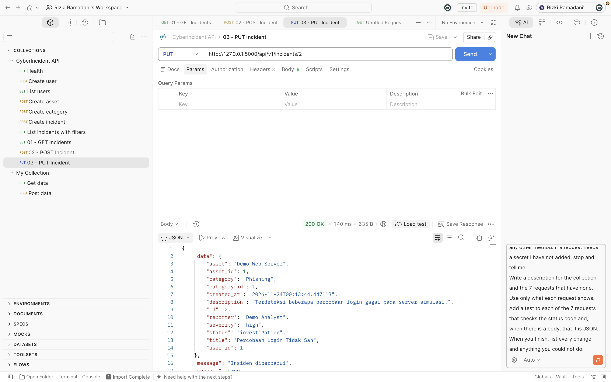
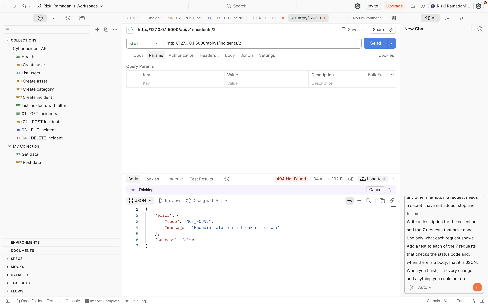
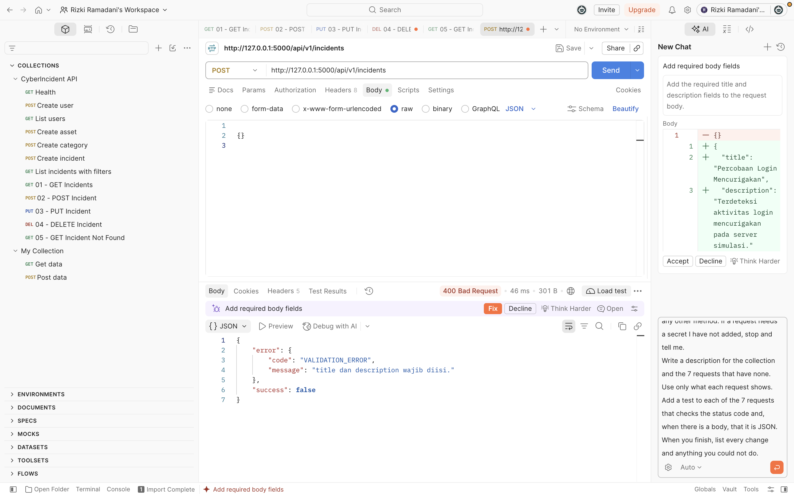

# CyberIncident API

CyberIncident API adalah project REST API sederhana untuk mencatat dan mengelola laporan insiden keamanan siber. Project ini dibuat menggunakan Python Flask dan database SQLite untuk tugas UTS Pemrograman Web Lanjut.

## Identitas Mahasiswa

- **Nama:** Rizki Ramadani
- **NIM:** 23.83.1015
- **Kelas:** TK070
- **Prodi:** Teknik Komputer
- **Universitas:** Universitas Amikom Yogyakarta
- **Mata Kuliah:** Pemrograman Web Lanjut

## 1. Tujuan Project

Project ini dibuat untuk mempelajari cara membuat REST API, mengelola data menggunakan database, dan menjalankan fungsi CRUD (tambah, lihat, ubah, dan hapus data).

## 2. Teknologi yang Digunakan

- **Python dan Flask:** Membuat REST API.
- **SQLite:** Menyimpan data.
- **SQLAlchemy:** Menghubungkan aplikasi dengan database.
- **Postman:** Menguji API.
- **pytest:** Melakukan pengujian otomatis.

## 3. Fitur Utama

- Mengelola data pengguna, aset, dan kategori insiden.
- Menambah, melihat, mengubah, dan menghapus laporan insiden.
- Mencatat perkembangan penanganan insiden.
- Menampilkan laporan menggunakan filter dan pagination.
- Memberikan pesan kesalahan jika data tidak sesuai atau tidak ditemukan.

## 4. Struktur Database

Project ini menggunakan lima tabel:

| Tabel | Kegunaan |
|---|---|
| `users` | Data pengguna |
| `assets` | Data aset |
| `incident_categories` | Kategori insiden |
| `incidents` | Laporan insiden |
| `incident_updates` | Riwayat perkembangan insiden |

## 5. Cara Menjalankan Project

Buka terminal di folder project, lalu jalankan perintah berikut.

**1. Membuat virtual environment**

```bash
python3 -m venv .venv
source .venv/bin/activate
```

**2. Menginstal library**

```bash
pip install -r requirements.txt
```

**3. Menyiapkan konfigurasi dan data contoh**

```bash
cp .env.example .env
python seed.py
```

**4. Menjalankan API**

```bash
python run.py
```

API dapat diakses melalui:

`http://127.0.0.1:5000`

## Demo API Online

CyberIncident API telah di-deploy menggunakan PythonAnywhere.

- Health Check: https://rizkirmadani.pythonanywhere.com/api/v1/health
- Daftar Insiden: https://rizkirmadani.pythonanywhere.com/api/v1/incidents

## 6. Endpoint API

| Method | Endpoint | Kegunaan |
|---|---|---|
| GET | `/api/v1/health` | Mengecek API |
| GET | `/api/v1/users` | Melihat pengguna |
| GET | `/api/v1/assets` | Melihat aset |
| GET | `/api/v1/incidents` | Melihat laporan |
| POST | `/api/v1/incidents` | Menambah laporan |
| GET | `/api/v1/incidents/{id}` | Melihat detail laporan |
| PUT | `/api/v1/incidents/{id}` | Mengubah laporan |
| DELETE | `/api/v1/incidents/{id}` | Menghapus laporan |
| GET | `/api/v1/incidents/{id}/updates` | Melihat riwayat laporan |
| POST | `/api/v1/incidents/{id}/updates` | Menambah riwayat laporan |

Endpoint lainnya dapat dilihat melalui file `openapi.yaml`.

## ERD Database

Database CyberIncident API menggunakan 5 tabel yang saling berhubungan, yaitu users, assets, incident_categories, incidents, dan incident_updates.

Diagram hubungan tabel dapat dilihat di [ERD CyberIncident API](docs/ERD.md).

## 7. Dokumentasi Pengujian Postman

Pengujian dilakukan menggunakan Postman untuk memastikan API berjalan dengan baik.

### GET Incidents — 200 OK

Menampilkan daftar laporan insiden yang tersimpan.


### POST Incident — 201 Created

Menambahkan laporan insiden baru ke database.


### PUT Incident — 200 OK

Mengubah status laporan dari `open` menjadi `investigating`.



### DELETE Incident — 200 OK

Menghapus laporan insiden berdasarkan ID.


### GET Not Found — 404

Menguji API saat data yang dicari tidak ditemukan.



### POST Validation Error — 400

Menguji API dengan mengirimkan data kosong. API menolak request karena judul dan deskripsi wajib diisi.



## 8. Pengujian Otomatis

Selain Postman, pengujian dilakukan menggunakan pytest dengan perintah:

```bash
python -m pytest -v
```

Hasil pengujian:

```text
4 passed in 0.11s
```

Artinya, keempat pengujian otomatis berhasil dijalankan.

## 9. Kesimpulan

CyberIncident API berhasil dibuat untuk mengelola laporan insiden keamanan siber menggunakan Flask dan SQLite. Dari hasil pengujian Postman dan pytest, fitur yang diuji dapat berjalan sesuai dengan fungsinya, termasuk saat menerima data yang tidak lengkap atau tidak ditemukan.

---

**Rizki Ramadani — 23.83.1015**  
Teknik Komputer — Universitas Amikom Yogyakarta